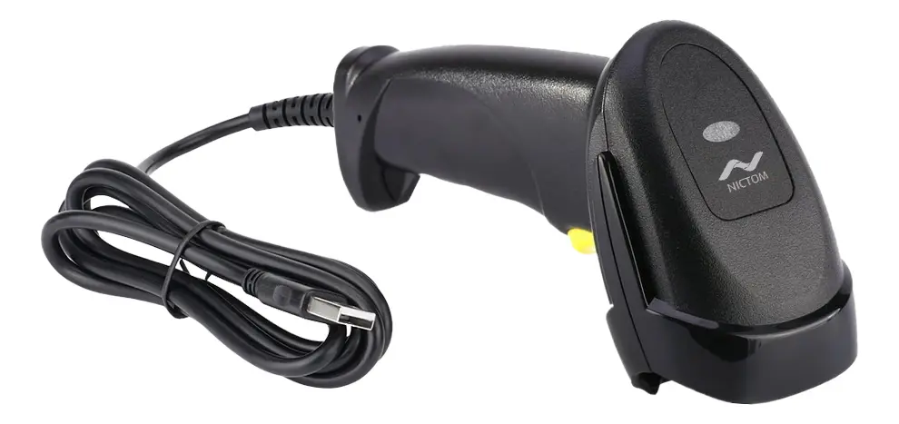

# NICTOM LCB6200

Soporte oficial para este lector de codigo de barras 1D y 2D.

Se puede conseguir en: [MercadoLibre](https://www.mercadolibre.com.ar/lector-de-codigo-de-barras-1d-y-2d-usb-qr-pdf-usb-500-lecturas-por-segundo-nictom-6200/p/MLA19122735)

Metodo de configuracion: lectura de codigos QR impresos en su propio manual fisico.