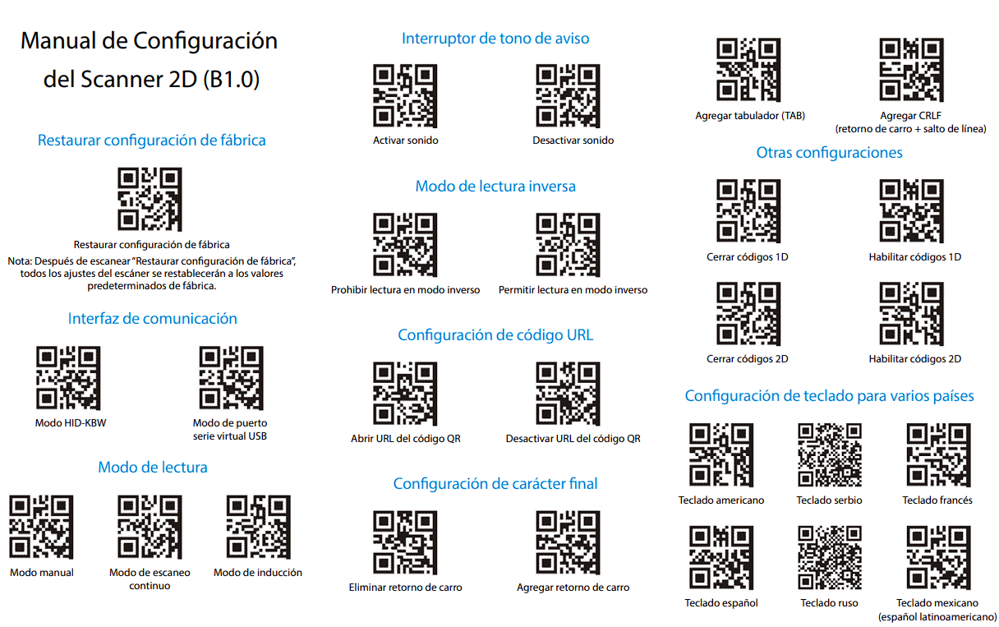

# OCOM OCBS-2088

## Descripcion

Soporte oficial para este lector de codigos de barras 1D y 2D.

Precio: :dollar: :dollar: :dollar:

Se puede conseguir en: [MercadoLibre](https://www.mercadolibre.com.ar/lector-codigo-de-barras-2d-con-cable-usb-ocom-cbase/up/MLAU187701781)

## Configuracion

Metodo de configuracion: lectura de codigos QR.

[!file](./Manual-OCBS-2088.pdf)