# Configuración del Servidor de IA y Agente VS Code

Esta guía detalla el proceso de instalación, configuración y puesta en marcha de un modelo de lenguaje de gran tamaño (LLM) en un servidor local, junto con su integración completa en el agente de VS Code para aprovechar capacidades de Tool Calling y Vision.

| | |
|---|---|
| Modelo LLM | [!badge icon="download" text="Gemma 4 26B A4B IT UD Q4_K_XL"](https://huggingface.co/unsloth/gemma-4-26B-A4B-it-GGUF/resolve/main/gemma-4-26B-A4B-it-UD-Q4_K_XL.gguf?download=true) |
| Modelo MTP | [!badge icon="download" text="MTP Gemma 4 26B A4B IT Q8"](https://huggingface.co/unsloth/gemma-4-26B-A4B-it-GGUF/resolve/main/MTP/mtp-gemma-4-26B-A4B-it-Q8_0.gguf?download=true) |
| Capacidades | [!badge icon="tools" variant="info" text="Tool calling"] [!badge icon="eye" variant="info" text="Vision"] |

## Prerrequisitos

Para obtener el máximo rendimiento, se recomienda contar con hardware dedicado, como una GPU NVIDIA (por ejemplo, una RTX 3090).

También necesitarás tener instalados:
- [LM Studio](https://lmstudio.ai/) (con acceso a la CLI `lms`)
- [Visual Studio Code](https://code.visualstudio.com/)

---

## 1. Preparación de los Modelos

Para un funcionamiento óptimo con aceleración MTP (Multi-Token Prediction), necesitamos descargar tanto el modelo principal como el modelo de borrador (draft model).

>>> Descargar e importar el modelo MTP
Creamos un directorio temporal y descargamos el modelo MTP directamente:
```bash
mkdir -p ~/Downloads/gemma4
wget -c "https://huggingface.co/unsloth/gemma-4-26B-A4B-it-GGUF/resolve/main/MTP/mtp-gemma-4-26B-A4B-it-Q8_0.gguf" -P ~/Downloads/gemma4/
```

Luego, lo importamos a la gestión de LM Studio:
```bash
lms import ~/Downloads/gemma4/mtp-gemma-4-26B-A4B-it-Q8_0.gguf --user-repo "unsloth/gemma-4-26B-A4B-it-GGUF" -y
```
Al recibir la advertencia de movimiento de archivo, confirma con `Y`.

>>> Descargar el modelo LLM
Para el modelo principal, utilizaremos la interfaz interactiva de la CLI para seleccionar la versión específica:
```bash
lms get "https://huggingface.co/unsloth/gemma-4-26B-A4B-it-GGUF" --gguf --select
```
En la lista que aparece, selecciona la versión `Q4_K_XL`. Una vez finalizada la descarga, el modelo estará disponible automáticamente en tu repositorio local.

---

## 2. Ejecución del Servidor de IA

La herramienta CLI de LM Studio no soporta actualmente la carga de modelos MTP de forma nativa. Por ello, utilizaremos `llama-server` directamente para habilitar esta funcionalidad.

!!!tip Aceleración MTP
La configuración de predicción MTP de 3 tokens ofrece un equilibrio ideal, permitiendo acelerar la generación de texto en aproximadamente un 50%.
!!!

>>> Verificación de archivos
Antes de arrancar, asegúrate de que ambos modelos residen en la misma carpeta de LM Studio:
```bash
ls -lh ~/.lmstudio/models/unsloth/gemma-4-26B-A4B-it-GGUF/
```

>>> Lanzamiento del servidor
Ejecuta el siguiente script para configurar las variables de entorno de CUDA y arrancar el servidor con los parámetros optimizados para MTP y Vision:

```bash
# Directorios de LM Studio
BASE="$HOME/.lmstudio/extensions/backends"
BACKEND="$BASE/llama.cpp-linux-x86_64-nvidia-cuda12-avx2-2.67.0"
VENDOR="$BASE/vendor/linux-llama-cuda12-vendor-v1"
MODEL_DIR="$HOME/.lmstudio/models/unsloth/gemma-4-26B-A4B-it-GGUF"

# Bibliotecas CUDA 12
export LD_LIBRARY_PATH="$BACKEND:$VENDOR${LD_LIBRARY_PATH:+:$LD_LIBRARY_PATH}"

# Ejecutar desde el directorio original del backend
cd "$BACKEND" || exit 1

./llama-server \
  --model "$MODEL_DIR/gemma-4-26B-A4B-it-UD-Q4_K_XL.gguf" \
  --spec-draft-model "$MODEL_DIR/mtp-gemma-4-26B-A4B-it-Q8_0.gguf" \
  --spec-type draft-mtp \
  --spec-draft-n-max 3 \
  --spec-draft-ngl 99 \
  --ctx-size 96000 \
  --n-gpu-layers 99 \
  --parallel 1 \
  --batch-size 2048 \
  --ubatch-size 2048 \
  --mtmd-batch-max-tokens 2048 \
  --cache-type-k f16 \
  --cache-type-v f16 \
  --flash-attn on \
  --mmproj "$MODEL_DIR/mmproj-F32.gguf" \
  --image-min-tokens 280 \
  --image-max-tokens 1120 \
  --jinja \
  --alias gemma4-26b-mtp \
  --host 0.0.0.0 \
  --port 8080
```

Con esta configuración, el rendimiento esperado en hardware como una RTX 3090 es de entre 170 t/s y 270 t/s (con cache hits).

```text
+-----------------------------------------------------------------------------------------+
| NVIDIA-SMI 580.178.04             Driver Version: 580.178.04     CUDA Version: 13.0     |
+-----------------------------------------+------------------------+----------------------+
| GPU  Name                 Persistence-M | Bus-Id          Disp.A | Volatile Uncorr. ECC |
| Fan  Temp   Perf          Pwr:Usage/Cap |           Memory-Usage | GPU-Util  Compute M. |
|                                         |                        |               MIG M. |
|=========================================+========================+======================|
|   0  NVIDIA GeForce RTX 3090        Off |   00000000:01:00.0 Off |                  N/A |
|  0%   42C    P8             31W /  390W |   23646MiB /  24576MiB |      0%      Default |
|                                         |                        |                  N/A |
+-----------------------------------------+------------------------+----------------------+

+-----------------------------------------------------------------------------------------+
| Processes:                                                                              |
|  GPU   GI   CI              PID   Type   Process name                        GPU Memory |
|        ID   ID                                                               Usage      |
|=========================================================================================|
|    0   N/A  N/A          681385      C   ./llama-server                        23634MiB |
+-----------------------------------------------------------------------------------------+
```

---

## 2. Integración con VS Code (Agente Local)

Una vez que el servidor está operativo, debemos configurar el agente de VS Code para que lo utilice en lugar del servicio por defecto de Copilot.

>>> Configurar el Harness de VS Code
Por defecto, VS Code prioriza el harness de Copilot. Para usar tu servidor local, debes desactivar esta opción en la configuración:

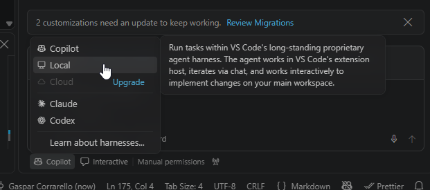
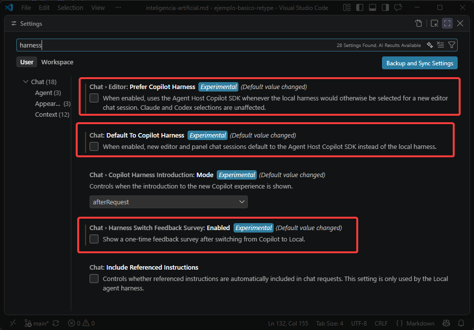

>>> Configurar el Endpoint Personalizado
Debemos crear una nueva entrada para nuestro servidor en la sección de Modelos de Lenguaje:

1. Abre el selector de modelos y pulsa en **Add Models...** 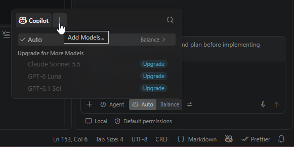
2. En el menú desplegable, selecciona **Custom Endpoint** 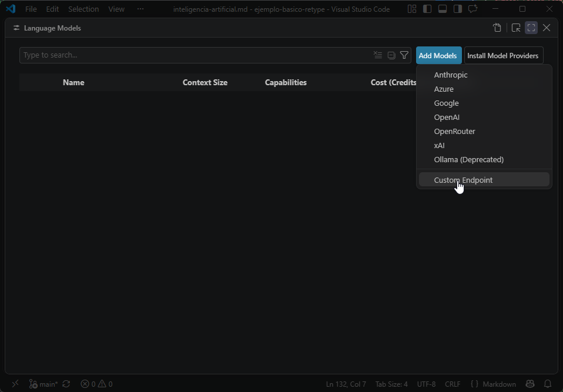
3. Completa la información del nuevo grupo de modelos:
   - **Nombre**: `Local`
   - **API Key**: (dejar en blanco)
   - **Tipo de API**: `Chat Completions`

Esto generará un archivo de configuración similar al siguiente 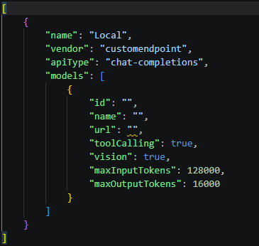. Reemplaza los valores de `url` con la dirección IP y el puerto de tu servidor:

```json
[
	{
		"name": "Local",
		"vendor": "customendpoint",
		"apiType": "chat-completions",
		"models": [
			{
				"id": "gemma-4-26B-A4B-it-UD-Q4_K_XL",
				"name": "Llama Server - Gemma 4 26B A4B IT UD Q4 K XL",
				"url": "http://[ip-servidor]:[puerto]/v1/chat/completions",
				"toolCalling": true,
				"vision": true,
				"apiType": "chat-completions",
				"contextWindow": 96000,
				"maxInputTokens": 75000,
				"maxOutputTokens": 21000,
				"streaming": true,
				"thinking": true
			}
		]
	}
]
```

>>> Verificar la conexión
Tras la configuración, el modelo local aparecerá en el selector del chat 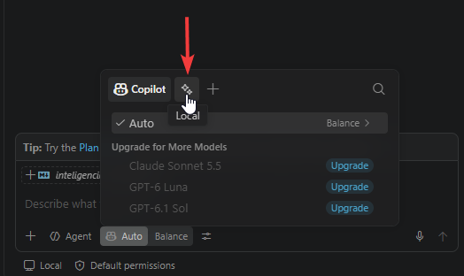 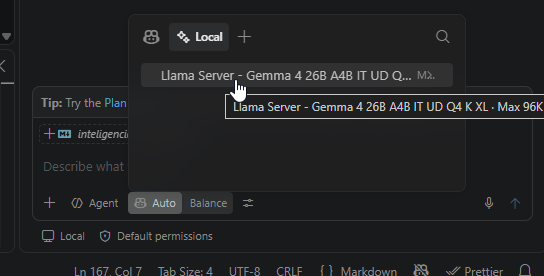 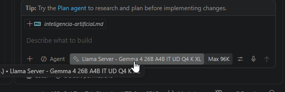.

!!!info
¡La conexión está lista! Ya puedes interactuar con tu modelo local desde el chat de VS Code.
!!!

---

## 3. Gestión de Herramientas y Skills

Para maximizar la utilidad del agente, es fundamental configurar correctamente sus herramientas y sus habilidades (skills).

### Herramientas (Tools)
Las herramientas activas para el chat se gestionan mediante el icono de configuración en la barra de entrada del chat 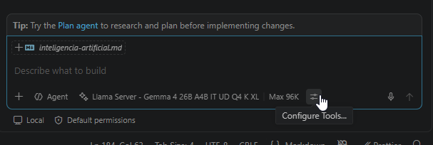. Al abrirlo, podrás seleccionar qué capacidades tiene disponibles el agente 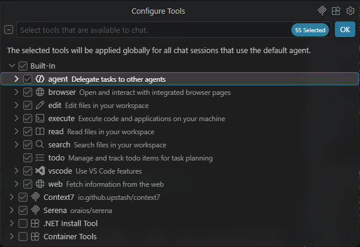.

### Skills
Las `skills` son instrucciones especializadas que puedes invocar mediante comandos.

>>> Crear una nueva Skill
1. En el chat, escribe `/skills` para activar el autocompletado 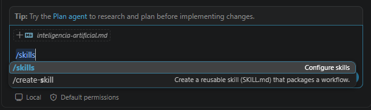.
2. Selecciona **New skill...** de la lista 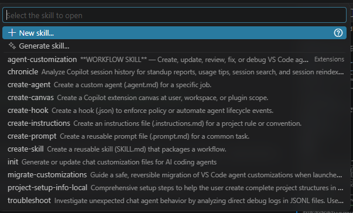.
3. Elige la ubicación. Para que esté disponible en todos tus proyectos, selecciona la opción **Global** 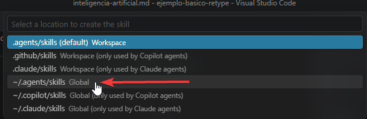.
4. Asigna un nombre a tu skill 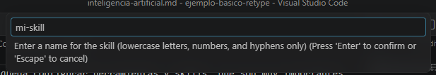.
5. Se abrirá un archivo `SKILL.md` donde podrás definir su comportamiento 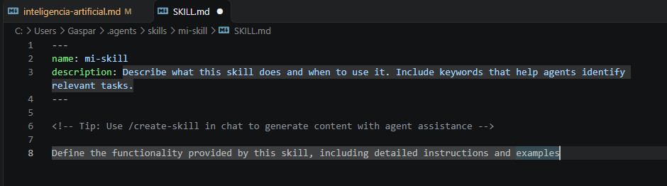.

Ejemplo de una skill sencilla:
```md
---
name: mi-skill
description: Agrega informacion relevante a las respuestas.
---
Cada mensaje redactado debe terminar con una linea al final que diga exactamente: "Esta respuesta fue generada con la ayuda de mi-skill."
```

>>> Usar una Skill
Para usar una skill, simplemente escribe `/` seguido de su nombre 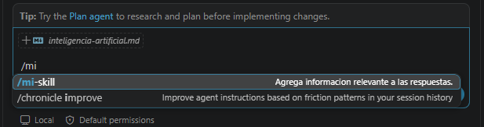 y pulsa `Tab` para completar 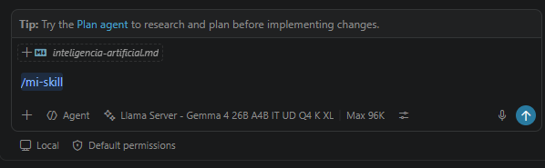. El agente aplicará las instrucciones de la skill al procesar tu solicitud 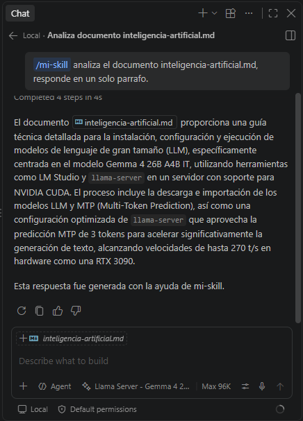.
