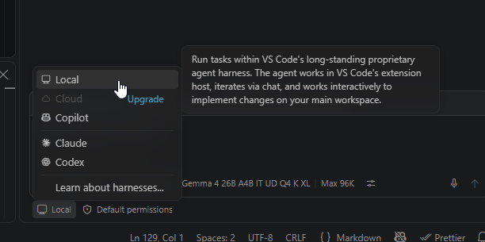
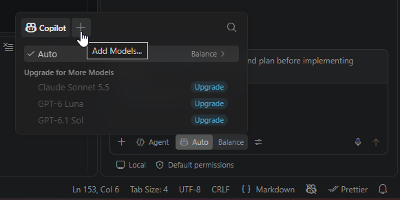
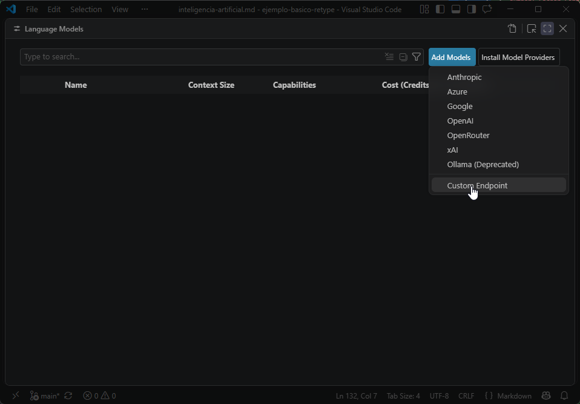
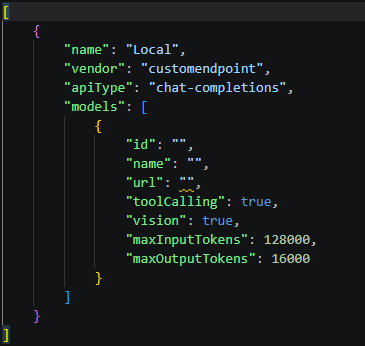
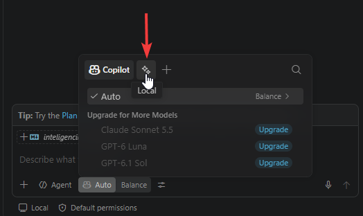
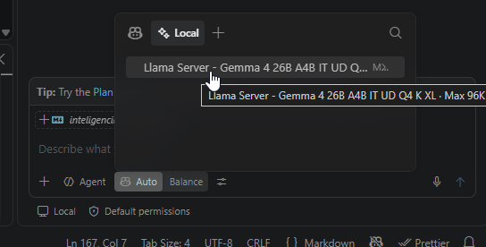
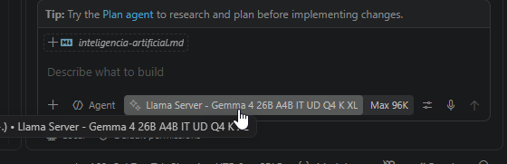

Instalacion, configuracion y arranque de modelo LLM en el servidor de IA.

| | |
|---|---|
| Modelo LLM | [!badge icon="download" text="Gemma 4 26B A4B IT UD Q4_K_XL"](https://huggingface.co/unsloth/gemma-4-26B-A4B-it-GGUF/resolve/main/gemma-4-26B-A4B-it-UD-Q4_K_XL.gguf?download=true) | 
| Modelo MTP | [!badge icon="download" text="MTP Gemma 4 26B A4B IT Q8"](https://huggingface.co/unsloth/gemma-4-26B-A4B-it-GGUF/resolve/main/MTP/mtp-gemma-4-26B-A4B-it-Q8_0.gguf?download=true) |
| Capacidades | [!badge icon="tools" variant="info" text="Tool calling"] [!badge icon="eye" variant="info" text="Vision"]  |


## 1. Descarga e importacion del modelo MTP

Creamos una carpeta donde descargar el modelo MTP y lo descargamos a esa carpeta:
```bash
mkdir -p ~/Downloads/gemma4
wget -c "https://huggingface.co/unsloth/gemma-4-26B-A4B-it-GGUF/resolve/main/MTP/mtp-gemma-4-26B-A4B-it-Q8_0.gguf" -P ~/Downloads/gemma4/
```

Despues lo importamos a `lms` con el siguiente comando:

```bash
lms import ~/Downloads/gemma4/mtp-gemma-4-26B-A4B-it-Q8_0.gguf --user-repo "unsloth/gemma-4-26B-A4B-it-GGUF" -y
```

Nos va a advertir que lo estamos moviendo, respondemos `Y` para que lo ponga en su carpeta.

## 2. Descarga del modelo LLM

Descargamos la version `Q4_K_XL` del modelo, seleccionandolo de la lista. Este comando no descarga automaticamente, sino que abre una lista interactiva para seleccionar la version que queremos, de esta lista elegimos la version `Q4_K_XL`.

```bash
lms get "https://huggingface.co/unsloth/gemma-4-26B-A4B-it-GGUF" --gguf --select
```

Una vez termina deberia estar disponible automaticamente, sin hacer importacion como hicimos para el modelo anterior.

## 3. Configuracion y Ejecución

Verificamos que esten los dos modelos dentro de la misma carpeta:

```bash
ls -lh ~/.lmstudio/models/unsloth/gemma-4-26B-A4B-it-GGUF/

total 19G
-rw-rw-r-- 1 user-ai user-ai 3.8K Oct 30 12:35 config.json
-rw-rw-r-- 1 user-ai user-ai  16G Oct 30 12:50 gemma-4-26B-A4B-it-UD-Q4_K_XL.gguf
-rw-rw-r-- 1 user-ai user-ai 2.2G Oct 30 12:39 mmproj-F32.gguf
-rw-rw-r-- 1 user-ai user-ai 441M Oct 30 12:41 mtp-gemma-4-26B-A4B-it-Q8_0.gguf
```

La herramienta CLI de LM Studio lamentablemente no proporciona opciones para carga de modelos MTP borrador, solo MTP simple, asi que vamos a ejecutar el `llama-server` directamente, saltandonos el CLI de LM Studio.

Despues de varias pruebas, llegue a la conclusion que prediccion MTP de 3 tokens es la mas adecuada, acelerando la generacion por un ~50%.

```bash
# Directorios de LM Studio
BASE="$HOME/.lmstudio/extensions/backends"

BACKEND="$BASE/llama.cpp-linux-x86_64-nvidia-cuda12-avx2-2.67.0"
VENDOR="$BASE/vendor/linux-llama-cuda12-vendor-v1"

MODEL_DIR="$HOME/.lmstudio/models/unsloth/gemma-4-26B-A4B-it-GGUF"

# Bibliotecas CUDA 12
export LD_LIBRARY_PATH="$BACKEND:$VENDOR${LD_LIBRARY_PATH:+:$LD_LIBRARY_PATH}"

# Ejecutar desde el directorio original del backend
cd "$BACKEND" || exit 1

./llama-server \
  --model "$MODEL_DIR/gemma-4-26B-A4B-it-UD-Q4_K_XL.gguf" \
  --spec-draft-model "$MODEL_DIR/mtp-gemma-4-26B-A4B-it-Q8_0.gguf" \
  --spec-type draft-mtp \
  --spec-draft-n-max 3 \
  --spec-draft-ngl 99 \
  --ctx-size 96000 \
  --n-gpu-layers 99 \
  --parallel 1 \
  --batch-size 2048 \
  --ubatch-size 2048 \
  --mtmd-batch-max-tokens 2048 \
  --cache-type-k f16 \
  --cache-type-v f16 \
  --flash-attn on \
  --mmproj "$MODEL_DIR/mmproj-F32.gguf" \
  --image-min-tokens 280 \
  --image-max-tokens 1120 \
  --jinja \
  --alias gemma4-26b-mtp \
  --host 0.0.0.0 \
  --port 8080
```

Con esta configuracion la RTX 3090 queda utilizada casi al maximo, y el output es desde 170t/s hasta 270t/s con cache hits. 

```
+-----------------------------------------------------------------------------------------+
| NVIDIA-SMI 580.178.04             Driver Version: 580.178.04     CUDA Version: 13.0     |
+-----------------------------------------+------------------------+----------------------+
| GPU  Name                 Persistence-M | Bus-Id          Disp.A | Volatile Uncorr. ECC |
| Fan  Temp   Perf          Pwr:Usage/Cap |           Memory-Usage | GPU-Util  Compute M. |
|                                         |                        |               MIG M. |
|=========================================+========================+======================|
|   0  NVIDIA GeForce RTX 3090        Off |   00000000:01:00.0 Off |                  N/A |
|  0%   42C    P8             31W /  390W |   23646MiB /  24576MiB |      0%      Default |
|                                         |                        |                  N/A |
+-----------------------------------------+------------------------+----------------------+

+-----------------------------------------------------------------------------------------+
| Processes:                                                                              |
|  GPU   GI   CI              PID   Type   Process name                        GPU Memory |
|        ID   ID                                                               Usage      |
|=========================================================================================|
|    0   N/A  N/A          681385      C   ./llama-server                        23634MiB |
+-----------------------------------------------------------------------------------------+
```

Una vez configurado el servidor LLM, hay que configurar el agente.

## 4. Configuracion del agente VS Code

Acabamos de configurar el servidor del modelo, ahora tenemos que configurar cómo lo vamos a usar.

1. Configurar VS Code con el harnes local.
	
2. Por defecto VS Code nos da opciones de LLM remotos, hay que crear la configuracion para usar nuestro servidor local.
	1. 
	2. 
	3. Y ahora nos pide informacion:
		- Nombre del grupo de modelos, elegir uno, como "Local".
		- API key en blanco, a menos que hayamos asignado una api key cuando configuramos el servidor.
		- Tipo de api: Elegir "Chat Completions" 
	4. Deberia generar y abrirnos un archivo asi:
		
		
		Que vamos a reemplazar por (reemplazando la ip y puerto por las de nuestro servidor):
		```json
		[
			{
				"name": "Local",
				"vendor": "customendpoint",
				"apiType": "chat-completions",
				"models": [
					{
						"id": "gemma-4-26B-A4B-it-UD-Q4_K_XL",
						"name": "Llama Server - Gemma 4 26B A4B IT UD Q4 K XL",
						"url": "http://[ip-servidor]:[puerto]/v1/chat/completions",
						"toolCalling": true,
						"vision": true,
						"apiType": "chat-completions",
						"contextWindow": 96000,
						"maxInputTokens": 75000,
						"maxOutputTokens": 21000,
						"streaming": true,
						"thinking": true
					}
				]
			}
		]
		```
3. Listo! ahora VS Code deberia mostrarnos, en una pestaña nuva, nuestro modelo local.
	
	
	

La conexion ya está lista para ser usada, solo queda configurar herramientas y skills, que son muy importantes.

!!!info
En este punto ya podemos probar y chatear con nuestro modelo LLM desde el chat de VS Code!
!!!